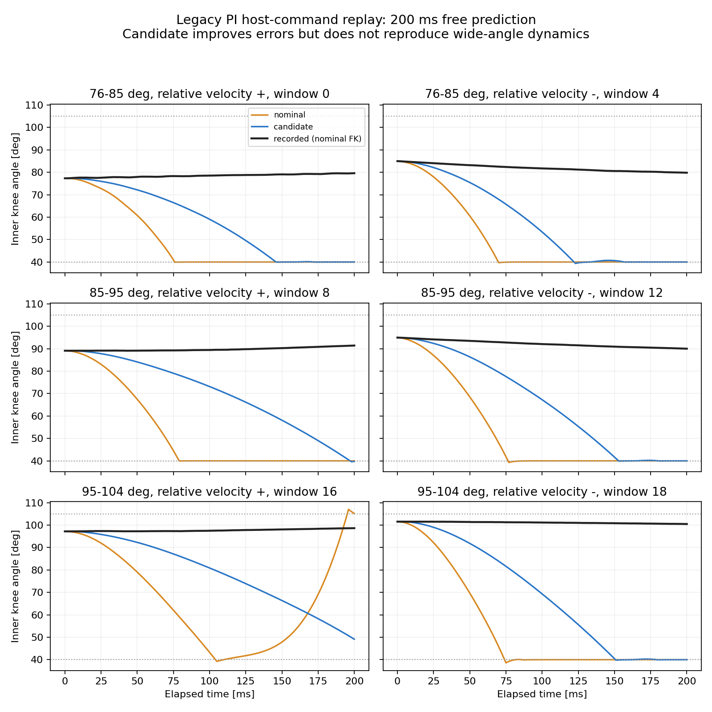

# 现有腿侧 bag 的角域覆盖审计（2026-09-29）

结论：现有左腿旧 PI 包 `013446` 确实包含比新 PD 包宽得多的相对膝运动；不能宣称“不重新录制就没有宽域数据”。它可用于下一步 host torque → motion 的跨控制器检验、重力/气簧负载约束。它不是完整的宽频辨识，也不是已获准进入训练的响应参数。当前轮侧冻结与训练迁移不依赖它通过。

## 数据与换算依据

- 原始诊断导出位于 `/home/yukikaze/Documents/workspace/RMCS/docs/zh-cn/artifacts/pair_rotation_chirp_v1/run_20260928T013446Z/`，含 `coverage_samples.npz`、`profile.yaml`、`coverage_summary.json`。
- 独立适配副本位于 `/tmp/v6-response-data/legacy_left_rotation_013446_host_command/`，没有修改原 bag 或原 NPZ。`response_1khz.json` 记录逐文件 SHA256、字段别名与缺项；`nominal_coverage.json` 记录逐段时窗、源行号和完整 FK 校验；`all_response_coverage.json` 对比其他已导出记录。
- 归档控制器的数组为 `[LH,LK,RH,RK]`，所选两轴为 `[0,1]`；`model_sign=[1,1,1,1]`，`model_offset=[-1.6,-2.93,1.6,2.93]`。V6 的两轴为 `L_joint1,LL_joint1`：`q_v6 = -(q_api * sign + offset)`，`delta_v6=q_aux_v6-q_hip_v6`。对全部 active 样本，独立的 `-(qref-ep)` 路径与该式最大差为 `4.45e-16 rad`。
- **两驱动轴角差不是内膝角。** 用 sealed final_r3 资产（manifest SHA256 `9542c788afd6e1b7f0af5e396062f123e511f63579cd8807087068e82e401c5c`）的闭链 FK 生成 delta→内膝角表。013446 的表覆盖 `delta=0.728413–1.384932 rad`；257 个节点，61 段各检查实际姿态的最小/中间/最大差角共 183 点，表与直接 FK 最大误差 `0.000392°`。没有在旧窄表之外盲目外推。
- 这些是**名义标定与资产几何条件下的内膝角**，不是新的实物膝角标定，也不是接触力证明。不能因某包算出 107° 就覆盖用户给出的 105° 名义限位和 106–107° 实际误差。

## 全部已导出记录的比较

下表统计整个 `phase=2`，不能与仅选少数拟合段的范围混用。“候选秒数”要求名义角 `<104°`，与任一 `>=104.5°` 样本前后距离均 `>100 ms`，且 `actuation_scope=1`；只用于筛选，没有凭此确认真实自由运动。

|记录 / 侧|原控制器|active 时长 s|名义内膝角 min–max|候选秒数|结论|
|---|---|---:|---:|---:|---|
|013446 / 左|位置/速度 PI，20 Nm|251.397|75.69–107.79°|247.601|唯一明显增加弯曲角域的旧包|
|040116 / 左|位置/速度 PI，20 Nm|687.301|104.33–109.40°|0|角差更宽主要朝伸展端；不能补自由弯曲域|
|050017 / 左|PD 60/2|687.301|106.48–107.89°|0|近伸展数据，不补宽域|
|054400 / 左|PD 120/3|671.420|102.57–107.29°|350.295|可补跨增益对照，角域仍窄|
|060953 / 右|PD 120/3|671.420|101.88–105.98°|643.489|可补右侧跨增益对照|
|073044 / 左|PD 160/2.5|671.420|100.12–106.98°|607.682|全包比当前拟合段稍宽，不能称只覆盖 102–105°|
|081447 / 左|PD 160/3|671.410|99.67–106.46°|630.097|比 160/2.5 多约半度弯曲，含 9.669 ms 间隙|
|144606 / 右|PD 160/2.5|671.420|99.82–105.73°|657.296|已有较长近伸展数据，未发现右侧对应宽域包|

其余 7 份 `response_1khz` 中 q/dq、参考、host command 和驱动反馈均为有限值；量化 `tau_frame_api` 的有限比例约 99.800%，周期性系统帧不能补成新力矩测量。除 081447 的长间隙外，最大周期 1.22–1.80 ms。另查 033540 的故障片段，差角范围对应仍在伸展端；`stop_response.npz` 只有 300 行、缺少完整时序/状态，不能替代全包辨识输入。

## 013446 的实际可用性

源 NPZ 共 253464 行，active 段共 251397 行；无记录队列丢样、tick 连续、末帧完成且无 failure。active 起始源行号为 **2066**（零基），host steady 为 **4763060144590 ns**，tick 6308。以下时间相对此行；端点按末样本再加 1 ms 表示半开窗口。拟合始终使用整数 steady 时间，不用 ROS 浮点 `stamp` 推断毫秒级延迟。

|段|时间 s|源行区间 `[start,stop)`|名义角 min–max|实际含义|
|---:|---:|---:|---:|---|
|5|9.800–10.601|11866–12667|89.48–100.39°|短阶跃响应，存在限幅|
|21|35.401–39.401|37464–41464|89.36–97.20°|整腿转动导致相对膝变化|
|29|59.401–63.401|61464–65464|86.66–94.17°|回转过程，髋限幅较多|
|35|77.400–117.400|79463–119463|85.75–99.82°|共模扫频，参考差角近固定|
|37|119.400–159.400|121463–161463|89.05–96.89°|相对参考扫频；实际大部分近停滞/漂移|
|53|202.400–206.400|204463–208463|75.69–90.65°|宽弯曲过渡，需保留重力与气簧|
|55|208.400–212.400|210463–214463|75.83–77.16°|较弯曲姿态回转|
|57|214.400–244.400|216463–246463|76.87–100.29°|原记录 `segment_role=1` 的联合验证段|

全 active 中名义角低于 100/95/90/85/80° 的累计时间分别为 243.703/189.217/97.101/20.898/12.488 s。按上述保守候选规则并要求 scope=1，剩余 247.601 s；其中 `|dq_aux-dq_hip|>0.1 rad/s` 有 66.973 s。再要求两轴均无限幅，剩余 37.746 s，其中相对运动有 12.337 s。**有意义的宽角域存在，但不可把这些时长解释成持续高频往复的时长。** 例如段 37 虽有 40 s，达到该相对速度标准仅约 0.692 s。

髋/膝整体限幅占比分别 24.64%/64.71%。这些样本可用已记录的限幅后输入解释 motion；不能拿未限幅参考或错误 PD 公式代替输入。架空仅固定车体，完整连杆/轮组重力与气簧必须保留。

## 字段语义与真实缺项

独立导出只重命名已存在字段，不虚构值：`q_api,dq_api,q_ref_model,dq_ref_model,position_error_model,tau_cmd_api,tau_preclip_model,torque_integral_model,torque_fb_api,feedback_steady_ns,feedback_sequence,control_steady_ns,tick,phase,segment_id,segment_role,segment_waveform,actuation_scope,torque_limited` 等。全 active 这些数值字段均有限。

- `tau_cmd_api` 来自旧 `tau`；在标定 sign 全为 +1 的本包，它与 `clip(preclip, -20, +20)` 逐样本完全相等。这是**未量化的 host 控制器输出**，不是已经确认送达的 MIT 帧，更不是实测轴力矩。
- `torque_fb_api` 来自旧 `tau_fb`，仅为 DM 驱动报告估计。没有把它当负载传感器真值，也没有把它作为输入拟合到自身。
- 原控制律是位置 Kp=6、速度 Kp=10、Ki=50/s、积分限幅 0.4；两驱动同时工作。禁止套 PD 160/2.5 重构输入；归档没有独立 `reference_frequency_hz` 字段，不能伪填 50 Hz。
- 缺 `tau_frame_api`、`tx_kind`、`tx_queued_steady_ns`、原始提交/接收 CAN 字节、`velocity_target_model`、`speed_error_model`、`repetition_id`、其他四轴与完整 IMU。原 MCAP 在已审阅本地目录中未找到，不能在本次声称完成原始帧复核。
- 503 个 active 样本 `actuation_scope=0`，不是已确认双轴纯扭矩作用；需排除或明确作为输入不确定区间处理，不能补成 scope=1。
- 最大 host tick 间隔 **3.964 ms**（中位 1.000、p99 1.084 ms）；短窗检查须拒绝跨异常间隙的窗口。两轴反馈最大 age 3.397/3.355 ms，存在 24/40 次序列重复；重复记录不是新设备反馈。
- 基座姿态在此子集未测得；固定车体水平、重力沿模型 -Z 是待对齐的回放假设。即使短窗有改善，也不能同时宣布重力/气簧/摩擦/惯量唯一可辨识。

## 已完成：跨旧 PI 包的 200 ms 短窗反例

独立适配器为 `scripts/validate_legacy_pair_response.py` 的 `LegacyReplay`。它继承原 `Replay` 的初态闭链求解、速度切向映射和前向积分；独立构造同一固定车体机械模型，没有修改原母类、校准入口或训练环境。适配器明确只接受 `host_command` 模式；调用 `closed_loop` 或伪称 MIT 输入会报错。

在查看任何仿真误差前，按 `[76,85)`、`[85,95)`、`[95,104)` 三个名义角箱、相对速度正负各选最早 4 个不重叠窗口。整个窗口均在同一角箱、同一原段、scope=1、反馈 age 不超过 5 ms、host 周期无大于 2 ms 的间隔、tick 连续且毫秒栅格偏差不超过 1 ms；至少 75% 的相对速度样本沿该方向且大于 0.05 rad/s，平均有向相对速度大于 0.1 rad/s。95–104° 正向只有 2 窗符合条件，其余配额均有 4 窗，**实际共 22 窗，没有为凑配额放松条件**。

每窗使用 201 个实测状态，包含 0 到 200 ms 的预测端点；实际记录端点跨度 199.920–200.022 ms。积分步长 1 ms，完整自由演化，窗口内部没有实测状态注入。评分用全部 201 点，无丢弃前 50 ms 或只算更短窗口。继承积分器在末端点记录后还执行一个未用于评分的 1 ms 步进；这不改变所比较的 0–200 ms 轨迹。

比较条件是当前 `stop105/urdf` 资产（SHA256 `875fa71e89d4d669af0a5471b2334f878d302e06f1b354fc245b95cb5d6f29ba`）、相同重力/气簧和 CAD 惯量；nominal 的额外 active armature/friction/damping/lag 均为零；候选固定使用 `/tmp/v6-response-results/left-fit-v2/parameters.json`，没有在旧包重新优化、改气簧或改力矩增益。

|名义内膝角箱 / 窗数|两驱动差角 RMSE，nominal→候选 rad|候选髋/辅助膝位置 RMSE rad|任一仿真膝限位作用占比，nominal→候选|
|---|---:|---:|---:|
|76–85° / 8|0.823→0.671|0.475 / 0.222|62.94%→24.19%|
|85–95° / 8|0.928→0.642|0.405 / 0.415|33.96%→5.78%|
|95–104° / 6|1.027→0.698|0.209 / 0.547|34.83%→4.81%|

这是按全部等长窗口均方误差合并后的 RMSE；差角指标是两驱动角之差，并非内膝角 rad。22 窗的差角 RMSE 均改善，但候选仍有 **18/22 窗** 错误碰到仿真膝限位，典型情况是坠向 **40° 屈曲下限**，并不是先前重点担心的 105° 伸展端。实测在这些窗口维持 76–104°，因此不能把改善解释成宽域响应模型已正确。全部回放没有 MuJoCo warning；最大闭链约束距离约 0.592 mm，不能用“仿真没报错”代替精度验收。

本结果支持两个明确判断：旧包提供了无需重录的宽域反例；当前候选在该反例上的绝对预测误差仍很大，**本轮不冻结腿侧参数进入训练**。应先检查名义坐标/架体姿态、气簧与重力负载、host 命令到实际输入的假设，再考虑跨包辨识；不能只增加惯量让错误运动变慢，就称辨识成功。现有子集缺少原始帧和 IMU，暂不能把具体根因唯一归给电机、气簧或摩擦。

证据见 `reports/v6_legacy_pair_response_20260929/{report.json,selection.json,summary.json,legacy_nominal_coverage.json,all_response_coverage.json}`；每个窗口的全轨迹保存在 `/tmp/legacy-left-response-validation-20260929-final/`。报告冻结脚本、母类、资产、候选及源 NPZ 的哈希。选择器/输入模式回归测试 `tests/test_legacy_pair_response.py` **7 项通过**，覆盖完整 200 ms、非重叠双向分箱、scope/缺力矩/过期反馈/时序跳变排除、配额不足明示和拒绝伪 PD/MIT 输入。
