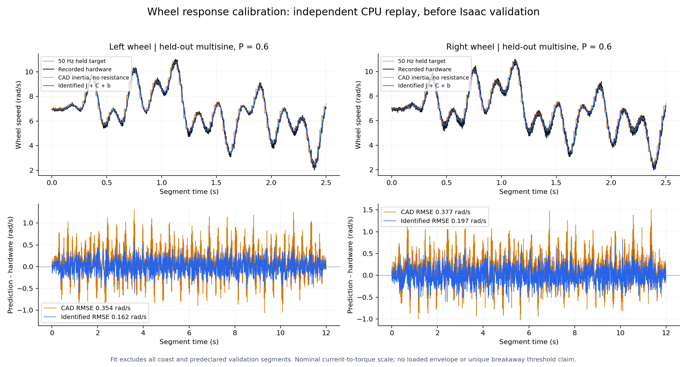

# 轮侧响应校准：名义有效惯量与运动阻力

2026-09-29。已完成现有三个 bag 的 CPU 离线拟合、跨增益回放及 Isaac 同轨迹验证，冻结了仅采用轮侧有效惯量和运动阻力的新研究合同。未操作机器人；远端接续以独立启动回执为准。本报告不是完整六轴电机模型的验证，以下离线结果与后续 Isaac 准入结果分开记录。

## 本轮实际完成

使用 `scripts/identify_wheel_response.py` 复算 P=0.6 包的运动阻力和有效惯量，并新增两个独立录制的 P=0.2/P=0.4 包作为整包留出。所有控制器增益保持实录值，I=D=0，1 kHz 速度 P、50 Hz 保持目标、轮输出端 ±4.5 N·m 限幅。15.8 减速比在 RMCS 输出口径已应用，不重复换算。

拟合仅用 P=0.6 单轮、非 validation、非 coast 的 50 ms 积分窗。整窗速度绝对值至少 1 rad/s、不反转、反馈年龄不超过 5 ms、原帧/标量速度一致、连续采样且腿部基本静止。左/右保留 2764/2732 个窗口。完整滑行段和轨迹设计预先标记的验证段都未进入拟合；不同增益来自此前录制的同轨迹族，不是新录的前瞻盲测。

模型为：

\[
J_{eff}\dot\omega = \tau_{nominal} - C_+\mathbf1_{\omega>0}+C_-\mathbf1_{\omega<0}-b\omega.
\]

| 轮 | J_eff kg·m² | C+ N·m | C− N·m | b N·m/(rad/s) | CAD轴向惯量 | 候选附加armature |
|---|---:|---:|---:|---:|---:|---:|
| 左 L_joint3 | .004441981 | .04929094 | .04972387 | .000608532 | .000575 | .003866981 |
| 右 R_joint3 | .004393454 | .06966972 | .06948452 | .000342903 | .000575 | .003818454 |

`J_eff` 是名义电流—力矩尺度下的总有效惯量，约为 CAD 轮轴惯量的 7.6–7.7 倍，包含减速器反射等未分开的贡献。表中附加量已经减去当前 URDF 沿关节轴投影的 CAD 惯量；部署前还必须核对 Isaac 实际读取的 armature/惯量，禁止把总 J 再加到已有 CAD 上。

左右正负库仑系数差分别仅 .000433/.000185 N·m。若使用只能表达对称摩擦的引擎接口，可明确采用均值 .04950740/.06957712 N·m；这是有记录的简化，需在相同 Isaac 回放中验证。不能把轮速 P=.6 填成被动物理黏滞系数。

## 量化结果与范围

下表每格是按段等权的闭环轮速 RMSE，单位 rad/s，每轮每种增益各 22 个预定义验证段，包含单轮多正弦、双轮同向/反向的阶跃、扫频、多正弦及相邻过渡。基线是“CAD惯量、零额外阻力”的独立单轴模型；它不是已经跑过的 Isaac 结果。

| 实录增益 | 左：基线 → 拟合模型 | 右：基线 → 拟合模型 |
|---|---:|---:|
| P=.6，同包留出 | .3501 → .1898 | .3761 → .2129 |
| P=.2，整包留出 | .5307 → .1566 | .5986 → .2060 |
| P=.4，整包留出 | .3781 → .1665 | .4079 → .1929 |

132 个闭环用例均比上述基线改善，而不是只有整体均值改善。这支持将有效惯量与运动阻力作为**有限用途的研究模型**继续做 Isaac 验证；不意味着每个残差都已解释。

P=.6 的六个零电流滑行段平均 RMSE 左/右 .2807/.6853 rad/s；跨 P=.2 为 .2992/.6904，跨 P=.4 为 .2714/.5266。单独使用记录的力矩开环回放 22 个验证段，P=.6 平均 RMSE 左/右 .8555/1.1378 rad/s；跨 P=.2 为 .5385/.9797，跨 P=.4 为 .4220/.9181。开环残差明显大于闭环，不能仅凭反馈控制下接近就声称物理辨识完全准确。



## 哪些项没有混入候选

- **额外响应滞后**：命令到记录反馈电流最优简化通道为 1 tick 偏移、2.5 ms 时间常数，但动态增益约 .76/.78，与稳态接近 1 的电流关系不一致。报告电流动态和真实轴力矩动态没有独立分离，因此没有将这个 lag/gain 直接写成执行器真值。现有 J 本身已吸收部分未分离动态，再叠加滞后可能重复计算。
- **静摩擦/预滑移**：近零时同一名义力矩下存在先滑动后粘住的历史效应。只用运动库仑项的模型仍无法正确解释所有 ±.2/.5 rad/s 段。保留低速逐段反例，不把某次 RMSE 改善当成唯一 Fs 已辨识。训练若接入本轮模型，应明确这是对理想无阻力模型的增量修正，而非完成了静止响应。
- **满载与高速包络**：原始预设目标覆盖约 ±30 rad/s。悬空轮转动不能证明满载峰值力矩、90 rad/s 上限、轮胎接地摩擦或热降额。超出数据域仍是工程先验，不能称作 bag 验证区间。
- **反馈时序/尺度不确定性**：20 ms 与 100 ms 积分窗得到的 J 左约 .004124–.004511、右 .003924–.004486，说明短时动态/反馈噪声影响估计。报告保留段级 bootstrap 敏感性，它不是绝对物理参数置信区间。
- **P=.4 包完整性**：旧包缺少正常封包完成事件且有局部调度间隙。本轮只评分连续且载体安静的片段，原质量原因和数据 SHA 全部保留，不改写为完整采集验收通过。

## Isaac 接口与训练复习

数据 NPZ `q_api/dq_api/tau_frame_api` 中左右轮为列 4/5；训练 active order 的轮列为 2/5。必须按 `L_joint3/R_joint3` 名称绑定。脚本候选 JSON 明确单位、减速比只转换一次、J 的 CAD 扣除及适用域。

应在车体固定、轮悬空条件下复现原始 50 Hz 保持目标，以 1 kHz P 回路比较名义/候选两套模型；至少包括左右单轮正反多正弦、两方向滑行、低速反例及双方同向/反向轨迹。若采用固定腿载体近似，要保留实录腿姿安静筛选并说明这个边界。

如果实际 Isaac 回放确认上述改善，可以冻结“有效惯量+运动阻力”版本，而把 Fs、独立力矩滞后、热/满载包络继续列为未完成。新 plant 会使相同动作的响应改变；旧策略可作为迁移初值，但旧 rollout/优势不再复用，也不能继承旧 plant 下的通过结论。需先评测，再对站立、定高、正反低速、起停做复习并复评，不能仅因载入旧 checkpoint 就跳过课程。最终接续规则由完整迁移合同定义，本报告不修改该合同。

## 复现与验证

```bash
OPENBLAS_NUM_THREADS=1 /home/yukikaze/isaacsim60-venv/bin/python scripts/identify_wheel_response.py \
  --data-root /home/yukikaze/Documents/workspace/RMCS/docs/zh-cn/artifacts/wheel_speed_v2 \
  --urdf model/纯底盘_v6_232mm_stop105/urdf/robot.urdf \
  --output /tmp/v6-wheel-response/result
```

核心结果：`reports/v6_wheel_response_20260929/wheel_response_fit.json`；最小候选：同目录 `wheel_response_candidate.json`。详细曲线数组保留 `/tmp/v6-wheel-response/result/wheel_response_curves.npz`，避免复制大包。

`tests/test_wheel_response_identification.py` 的 5 项验证通过：已知参数恢复、正反零电流滑行的耗散/不反转、P 与物理阻尼分离、CAD 惯量投影、coast/validation 不进入训练窗口。没有操作机器人，没有改变远端训练。

## Isaac 校准准入结果与新合同

本轮已在 Kaiser 的 Isaac Sim 6.0 中对同一 P=0.6 bag 的八段完整留出轨迹并行回放名义/候选，共16个独立台架环境。每段只写一次实测初态，随后自由积分；50 Hz目标、1 kHz PC速度P保持一致。报告见 `reports/v6_wheel_response_20260929/isaac_report.json` 与 `isaac_review.json`。

- 四个扫频段，实际运动轴 RMSE 从0.353–0.378降至0.162–0.207 rad/s，降低45.3%–54.1%。
- 四个正/反向断力矩滑行段，RMSE从8.05–8.53降至0.133–0.350 rad/s。
- 16个环境均读回native附加惯量、静/动/黏滞摩擦；附加惯量没有重复包含CAD。载体关节先在USD设置有限范围，再初始化物理，最大漂移约1.5e-6 rad/m。
- 与独立单环境完整131段对照，最大速度差约0.0012 rad/s。台架使用32/8求解迭代，正式环境仍保留64/32；该台架验证轮轴原生响应，不代表整车接地/自起验证。

研究准入：只采用两轮的有效惯量和运动阻力。对应新合同为 `contracts/v6_wheel_response_training_v1.json`，校准回执由 `v6_wheel_response_evidence_v1.json` 逐文件SHA绑定。四个腿轴维持原名义响应，关节PD160/2.5、轮P0.6、减速比15.8、控制时钟、网络、reward和预算均不变。时间常数保持0，不把电流反馈时延冒充独立轴力矩滞后。静摩擦预滑、满载高速、温度及自起交接仍未完成验证。

新旧训练源使用独立控制合同与设计表，旧文件保留。启用状态、六轴参数、证据哈希、PhysX实际读回、响应状态reset/阶跃探针任一不符均拒绝启动。接续前同检查点做旧/新各两种子评测，并按 `V6_RESPONSE_MIGRATION_20260929.md` 保留学习状态与全部已消费预算。此段记录校准和代码准入，不替代远端启动回执。
