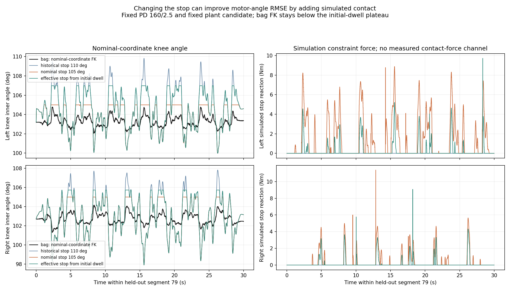

# 105°机械止挡确认、资产修订与整腿回放对照

2026-09-29。用户确认：**105°同时是标定角和名义机械限位，实际因误差可能到106/107°**。这里是大小腿物理内角，不是膝驱动编码器角。原文与来源见[user_constraints.json](user_constraints.json)。

判决：名义资产上限应改为105°；106/107°保留为有效止挡/设零误差尚未分离的工程情形。它们不是已测概率分布、严格公差或统计置信区间。用同一机械止挡设零会使编码器偏置与有效止挡相关，不能独立随机两次同一误差。此前“105还是110尚未确认”的问题已关闭。

## 已交付的新资产

独立目录 [model/纯底盘_v6_232mm_stop105](../../model/纯底盘_v6_232mm_stop105/BUILD_RECEIPT.md)，最终manifest `875fa71e89d4d669af0a5471b2334f878d302e06f1b354fc245b95cb5d6f29ba`。唯一物理变化是左右被动膝的两个伸展限位端点，对应内角上限110°→105°；下限40°、编码器映射、气簧、全部质量/惯量/COM及闭链保持不变。

75姿态闭链检查、4个MuJoCo场景及单环境PhysX固定底盘3.02秒小摆完成；封装工具50项测试通过。额外[消费端验证](consumer_receipt.json)确认泛化后的关节映射审计覆盖40–105°的左右70姿态，回放器实际编译出两侧40–105°限位、PD160/2.5及1ms步长；辨识/映射41项回归测试通过。消费端检查不冒充整包动力学验证。

MuJoCo检查中软止挡最大穿透约0.477°，是当前求解器顺应性，不是实车公差测量；PhysX小摆没有触碰上止挡，不证明冲击或止挡刚度正确。完整限制见资产回执。旧r3的110°资产、CPU-only版本及20k容量证据均保留原哈希；旧20k结果不能当作新105°版本已经跑过的记录。新资产仍为G1 pending，未发布正式训练。

## 数据与可辨识范围

左右bag均为完整机构架空、底盘固定，PC PD160/2.5、1kHz控制、50Hz目标；保留重力、气簧及并联耦合。[全样本几何审计](coverage/README.md)每侧671420个运行样本，FK抽查最大误差小于0.000406°。

|量|左腿|右腿|
|---|---:|---:|
|起始停靠段末500样本，直接FK平台中位|106.9841°|105.7330°|
|拟合及留出动态段的内角最大值|104.7907°|104.1575°|
|这些动态段距离起始平台的最小间隙|2.1934°|1.5755°|

平台值是在现有编码器映射下算出的有效角，不是外部量具测出的物理止挡；与用户所述误差方向相容，不能据此区分零偏、制造公差和受载变形。拟合9/11/13/15、留出37/39/41/43/79/89的全部样本均低于名义105°。几何证据支持它们离开起始上止挡，但bag没有直接接触力传感器。全包物理膝内角仅约100–107°，大腿共同转动不等于膝内角覆盖40–105°，不得将此包称为整个伸缩域辨识完成。

## 130个固定参数对照

运行源提交 `d7b2dd7af423660b97a9be09ce1ecbc94d43b60e`；命令、输入和脚本哈希见[launch.json](replay/launch.json)、[左右原始报告](replay/left/report.json)和[右报告](replay/right/report.json)。Kaiser实验目录为 `/home/kaiser/robot-rl-sim60/experiments/v6-stop-comparison-20260929`，tmux任务已完成。

每侧固定既有六参数、PD、编码器映射和1ms步长，对照110、105、106、107及本侧起始平台5种止挡。每种包含6个整段闭环留出，以及起始段和6个留出段各1秒实发力矩输入回放，共65例/侧。没有重新拟合参数、钳制初态或额外预稳定；初态已越过候选止挡的情形单独标记。平台只由seg0取得，不从留出段拟合。

|侧/止挡|髋/膝驱动角RMSE（rad）|仿真膝止挡约束激活比例|
|---|---:|---:|
|左110°|0.02404 / 0.01920|0.37%|
|左105°|0.01574 / 0.01293|33.14%|
|左平台106.984°|0.02123 / 0.01683|14.09%|
|右110°|0.01895 / 0.02274|0%|
|右105°|0.01428 / 0.01767|21.37%|
|右平台105.733°|0.01572 / 0.01927|15.71%|

RMSE是六段分别计算后取算术平均；约束激活比例按样本数加权，判据为仿真被动膝限位约束力矩幅值>1e−6Nm，**不是实机接触比例或电机饱和比例**。完整五种结果见[comparison_summary.json](comparison_summary.json)。

曲线来自本实验TensorBoard event；绘图脚本为 `scripts/plot_pair_stop_comparison.py`。实测内角采用已校验的同一FK表，无额外角度平移或时间扭曲。完整event保留在远端左右输出目录。

**不能将105°下更小的闭环误差算作电机模型通过。** 仿真在动态段频繁触碰止挡，而实测几何离起始平台仍有间隙；即使使用本侧平台止挡，这个矛盾仍存在。原六参数来自旧110°条件拟合，止挡对照不是新参数优化。当前改善包含限位约束改变轨迹的效应，需要另查自由运动动力学与参考映射。

六个留出段的1秒力矩输入回放，改105°后左右两轴平均RMSE仍约1.07–1.21rad。该结果也没有被止挡修正解决；但1秒开环误差受初态、延迟和积分敏感性影响，不能单独用它指定唯一故障原因，也不把“任意长开环必须完全重合”设成普适验收条件。seg0在105°情形初态超过止挡约左1.98°、右0.73°，相关结果保留诊断标记，不算完成零位标定。

## 后续接入顺序

1. 名义几何固定105°；有效止挡与编码器偏置在同一校准版本中表示。只靠bag平台无法唯一拆分，当前不发布独立的两份随机化。
2. 使用已有bag的保守离止挡窗口，按姿态和进入方向分层；检查短时多初态力矩预测、共同/差动负载残差和静摩擦历史，再决定最小参数集。零位、摩擦、气簧和力矩gain不能无约束互相补偿。
3. 同一物理模型通过整段留出及Isaac同轨迹复现后，再接训练。现有约100–107°数据域以外的膝伸缩工况需要独立证据，不能以参数外推宣称全域通过。
4. 网络、20k环境基线及正式8500更新预算保持；本轮未启动正式PPO、未消费正式更新。资产构建成功和执行器辨识发布是两项不同验收。

历史零位报告原样保留；本报告和新版资产回执覆盖其中“止挡名义值尚待确认”的旧状态，不改写旧运行来源。回放比较用冻结的旧r3加显式限位覆盖；随后泛化的消费端读取新105°bundle，二者源码哈希分别记账，没有以新代码冒充旧实验来源。
